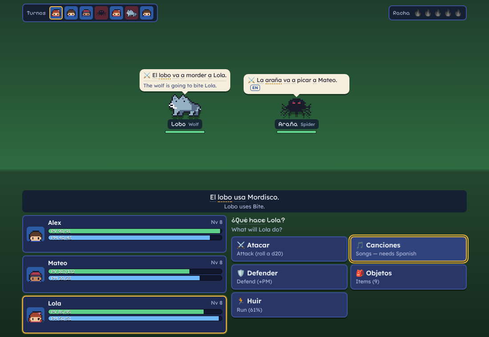
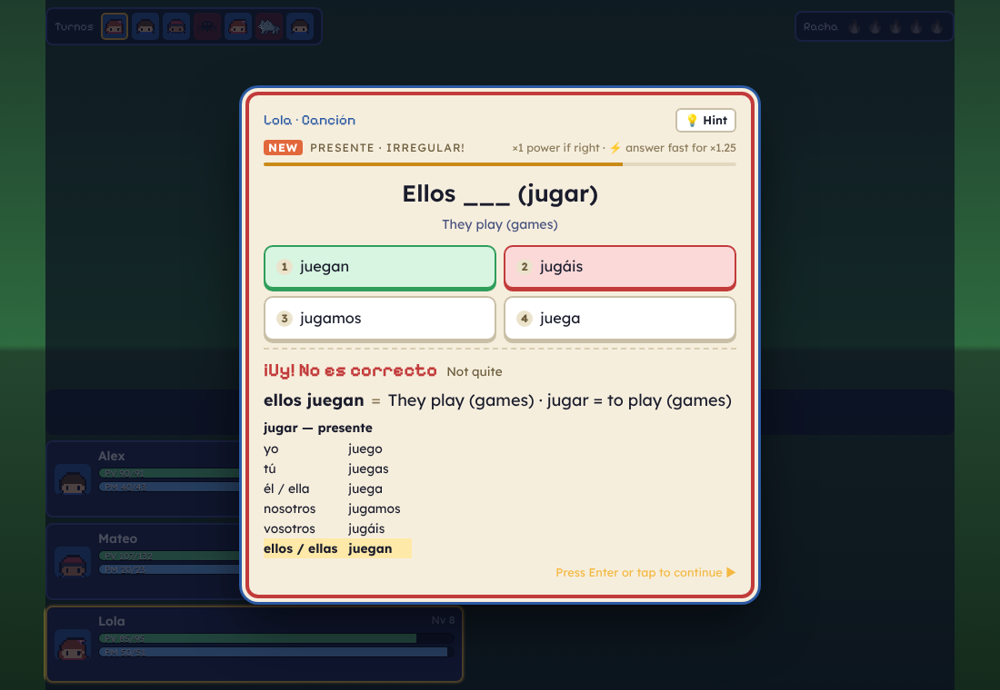
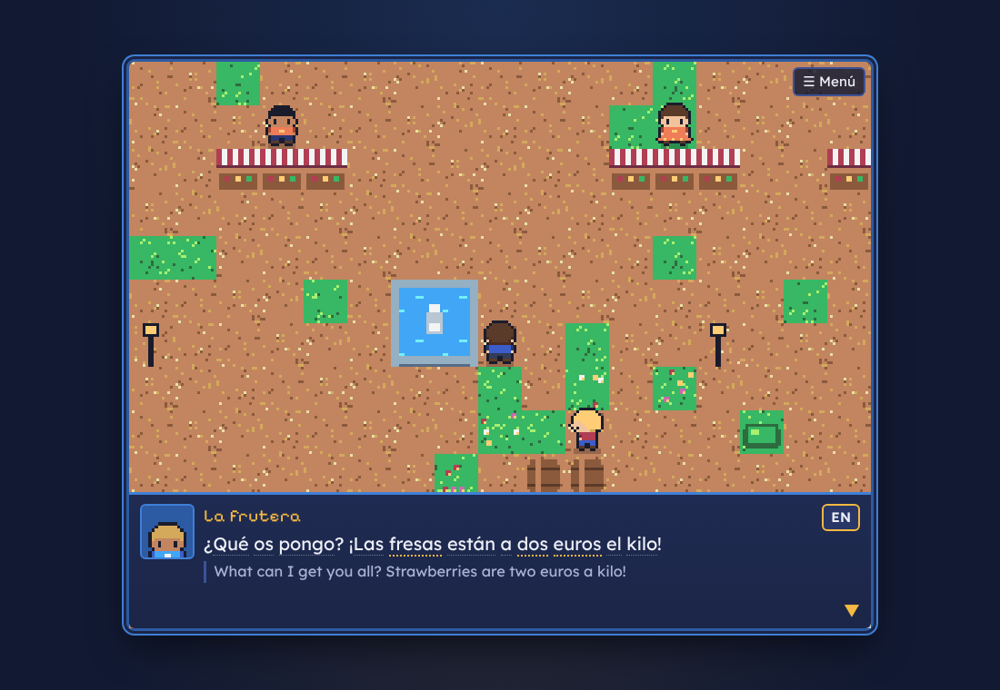

# Palabrista

A story-driven, turn-based RPG where your magic is the Spanish language — **Spanish from Spain**.

A grey fog called *El Silencio* is stealing the words of a little coastal village. Your grandmother,
the last *Palabrista* (word-mage), is struck silent. With Mateo the fisherman's son and Lola the
flamenco guitarist, you travel up the coast to the Mute Tower to win the words back.



## Run it

You need [Node.js](https://nodejs.org) 20 or newer.

```bash
git clone <this repo>
cd cloud-scratch
npm install
npm run dev
```

Then open the address it prints (usually <http://localhost:5173>).

Prefer a single file? `npm run build` writes `dist/index.html`, which runs straight from disk —
double-click it, or put it on a phone. Your progress is saved in the browser; *Menú → Ajustes* gives
you a save code to carry it to another device.

**Sound:** Spanish is read aloud by your browser's own text-to-speech. The game picks a Spain
(es-ES) voice when one is installed — on Windows that's *Microsoft Helena/Pablo/Laura*, on macOS
*Mónica/Jorge*, and Chrome ships *Google español*. If you hear nothing, add a Spanish voice in your
OS settings.

## How it plays

- **Explore** a pixel-art coast: a fishing village, a market town, a whispering forest, a snowy
  monastery and the tower at the end. Talk to everyone — many villagers have lost a word and need
  you to give it back.
- **Fight** in turn-based battles. A timeline shows who acts next (speed matters). Basic attacks roll
  a d20. Elements combo, BG3-style: 💧 *Agua* makes enemies wet, ⚡ *Rayo* then does double damage,
  ❄️ *Hielo* freezes them solid.
- **Read the enemy.** Every enemy announces its next move in Spanish — *«El cangrejo va a pellizcar a
  Mateo»*. Understand it and you can protect the target, defend, or sing the enemy to sleep before a
  big attack lands.
- **Cast with Spanish.** Special moves open a quick challenge. Right = full power, fast = bonus,
  wrong = a weak spell plus the correct answer and a short explanation. Each party member trains a
  different skill:
  - **You** — vocabulary and Spain expressions, from recognising a word to typing it from memory.
  - **Mateo** — quick decisions: *el/la* (with the traps: *el agua, el día, la mano, el problema*),
    *ser* vs *estar*, *por* vs *para*.
  - **Lola** — verbs: full conjugation including *vosotros*, the Spain-style *pretérito perfecto*
    (*hoy he comido*), *indefinido* vs *imperfecto*, and *gustar*.
- **Racha.** Right answers fill a streak meter. When it's full, unleash a *Palabra Final* by
  building a Spanish sentence from word tiles.

## What it teaches (and why)



It's built to sit next to Duolingo and fill the gaps an app course tends to leave:

| Gap | What the game does |
| --- | --- |
| Latin American focus | Spain throughout: *vosotros* everywhere, *zumo, patata, vale, ¡qué guay!, ¿me pone…?, te echo de menos*, a Spain voice |
| Recognition over recall | Words you know graduate from multiple choice to typing from memory (turn on *Typing focus*) |
| Thin grammar explanations | Every mistake shows the rule: gender rules, ser/estar uses, por/para uses, a full conjugation table |
| Ser/estar, por/para, gustar | Drilled as fast decisions, with the classic edge cases (*la fiesta es en…*, *está listo / es listo*) |
| Past tenses | Spain's *perfecto* for today, *indefinido* vs *imperfecto* in the story's own flashbacks |
| Idioms | *estar hecho polvo, ser pan comido, meter la pata, quien calla otorga…* |



**Translations are always available.** Tap (or hover) any underlined word for its meaning — every
word in the story has an entry, including conjugated verbs. Press **EN** (or **T**) for the whole
line, or set translations to *Always*. In challenges, **💡 Hint** helps when you're stuck. The
**Grimorio** in the menu is your dictionary, verb tables and grammar notes, and **Repaso** gives you a
quick ten-question review anywhere.

A spaced-repetition scheduler decides what you practise: shaky words come back soon, known words
fade into the background, and mastered ones return days later.

## Controls

| | Keyboard | Touch |
| --- | --- | --- |
| Move | Arrows / WASD (hold Shift to run) | D-pad |
| Talk, confirm | Enter / Space / Z | A |
| Back | Esc / X | B |
| Menu | M | ☰ |
| Translate line | T | EN button |
| Hint · repeat audio | H · R | 💡 · 🔊 |
| Answer | 1–4 | tap |

## Project layout

```
src/
  data/       vocabulary, verbs (all tenses), grammar drills, sentences, items, glossary
  learn/      answer checking, spaced repetition, challenge generator, tap-to-translate dictionary
  battle/     rules (turn order, damage, combos, enemy AI), enemies, battle controller and screen
  world/      tiles, maps, overworld engine
  story/      the scripts for every chapter
  ui/         dialogue, challenge card, menus, title screen
  engine/     input, audio (chiptune synth), speech, pixel-art sprites
  art/        sprites as strings of palette characters
tests/        learning logic, battle rules, and map/story integrity
```

`npm test` runs the test suite: answer checking, conjugations, the scheduler, battle rules, and checks
that every map is walkable, every exit leads somewhere, and every Spanish word in the story has a
translation.
